<p align="center">
  <picture>
    <source media="(prefers-color-scheme: dark)" srcset="docs/brand/opsifier-banner-dark.png" />
    
  </picture>
</p>

Opsifier is an open-source, self-hosted control panel that deploys apps and databases on your own server from a web interface, using Docker Swarm and Traefik. The interface shows the state of everything at a glance. Every feature is included, and there are no paid tiers.

> **Status: early development.** Releases are published, but Opsifier is not ready for production yet. Expect breaking changes.

<p align="center">
  <picture>
    <source media="(prefers-color-scheme: dark)" srcset="docs/screenshots/overview-dark.png" />
    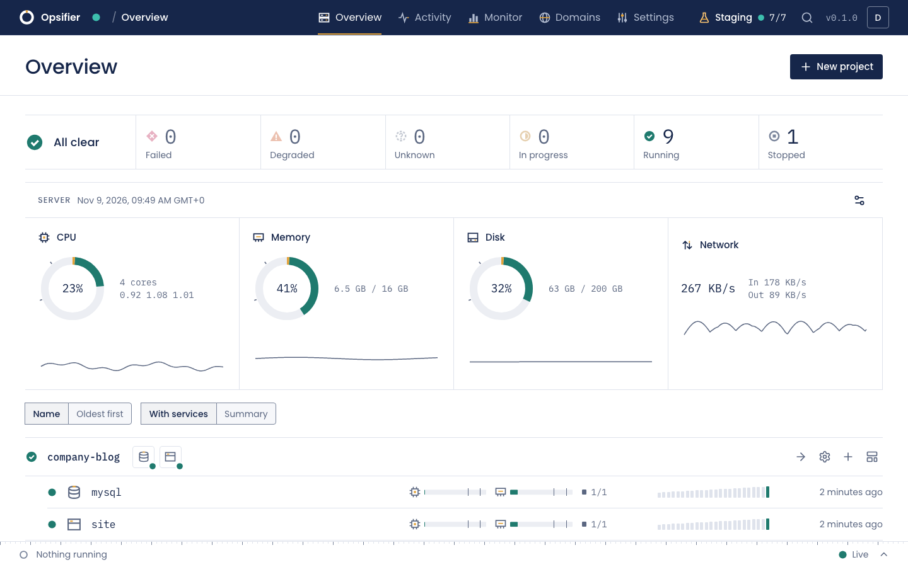
  </picture>
</p>

## What works today

- Projects and services with live status, deployment history and an activity log.
- Deployments from a Docker image, a Git repository, GitHub, an inline Dockerfile or an uploaded archive, with signed webhooks and deployment tokens.
- Going back to an earlier release in one action, with the exact image of every deployment recorded.
- Domains with HTTPS through Traefik, redirects, basic authentication and maintenance mode.
- A free `<id>.opsifier.dev` address on request, with one wildcard certificate. Someone approves each request, and a server can always use its own domain instead.
- Development, staging and production server roles. Anything that isn't production stays behind a password and out of search engines.
- Environment variables sealed at rest, with build inputs kept apart from runtime secrets, plus volumes, published ports, resource limits and replicas.
- Live logs with search, an in-browser console, per-service metrics and scheduled scripts with a run history.
- Postgres, MySQL, MariaDB, MongoDB and Redis, with managed credentials, optional public ports, backups you can download and restore, and networks kept apart between projects.
- Scheduled backups of databases and volumes to local disk, SFTP, FTP, S3-compatible storage, Dropbox or Google Drive, with retention, and restores that take a safety copy first.
- Compose stacks, ready-made templates, and a modular runtime with a browser IDE.
- A command line that takes a folder to a running app with `opsifier push`, and an MCP server, both held to the same rights as the API.
- Sign-in with two-factor authentication and recovery codes, project roles and API keys.
- Invitations, one or a hundred at a time. Each person gets a link that works once and expires after seven days, sent by e-mail or shown for you to pass on.
- Notifications by e-mail, Slack, Discord, Telegram or webhook, for deployments, backups, cleanups, disk usage and new releases.
- Updates from the panel itself, from the published releases, with a way back to the previous version.
- English and French, with light and dark themes.

WordPress sites, moving a project between servers, multi-node clusters and tunnels are still to come.

## Screenshots

Taken on a demo server with sample data.

<table>
  <tr>
    <td width="50%">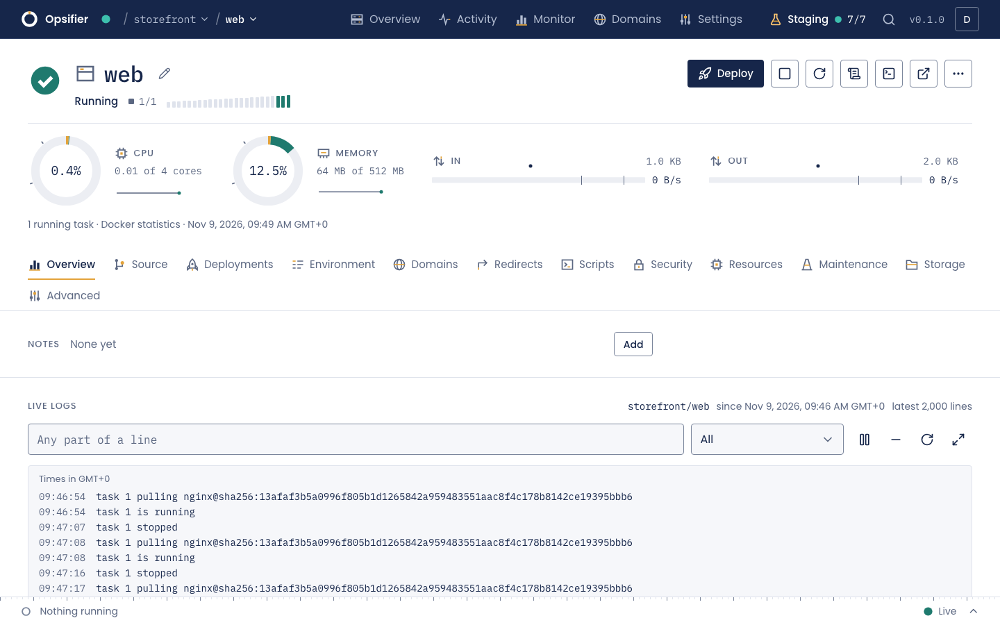<br /><b>A service.</b> Its state, resources and live logs on one page.</td>
    <td width="50%">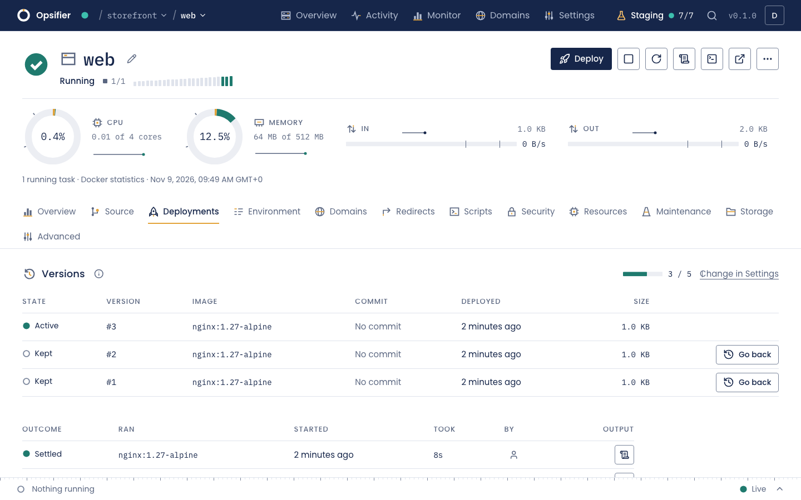<br /><b>Deployments.</b> Every version is recorded, and you can go back to it.</td>
  </tr>
  <tr>
    <td>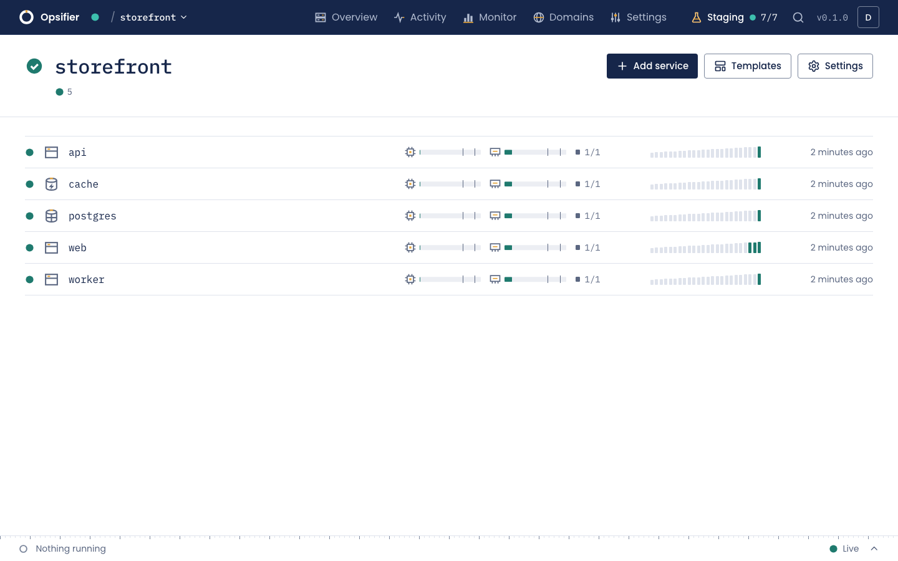<br /><b>A project.</b> Each service with a status light, its resources and its recent deployments.</td>
    <td>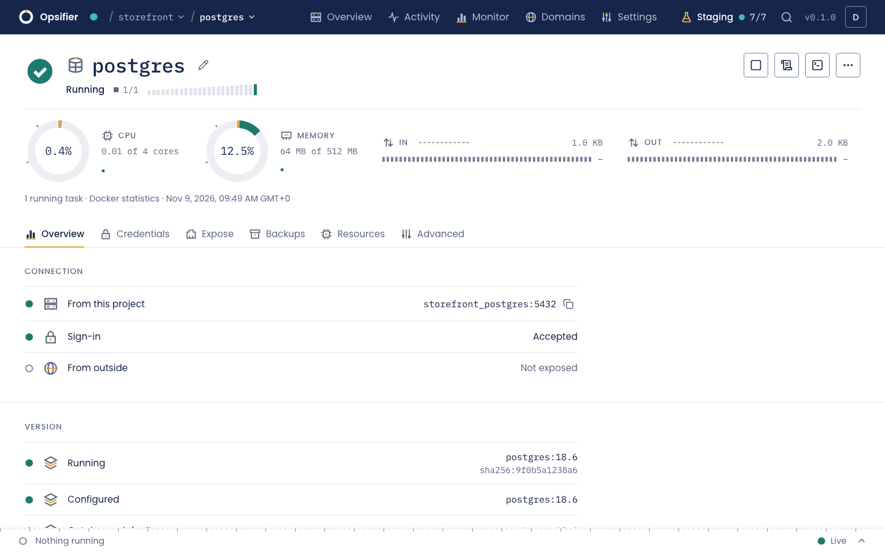<br /><b>Databases.</b> Credentials, connection details and backups in one place.</td>
  </tr>
  <tr>
    <td>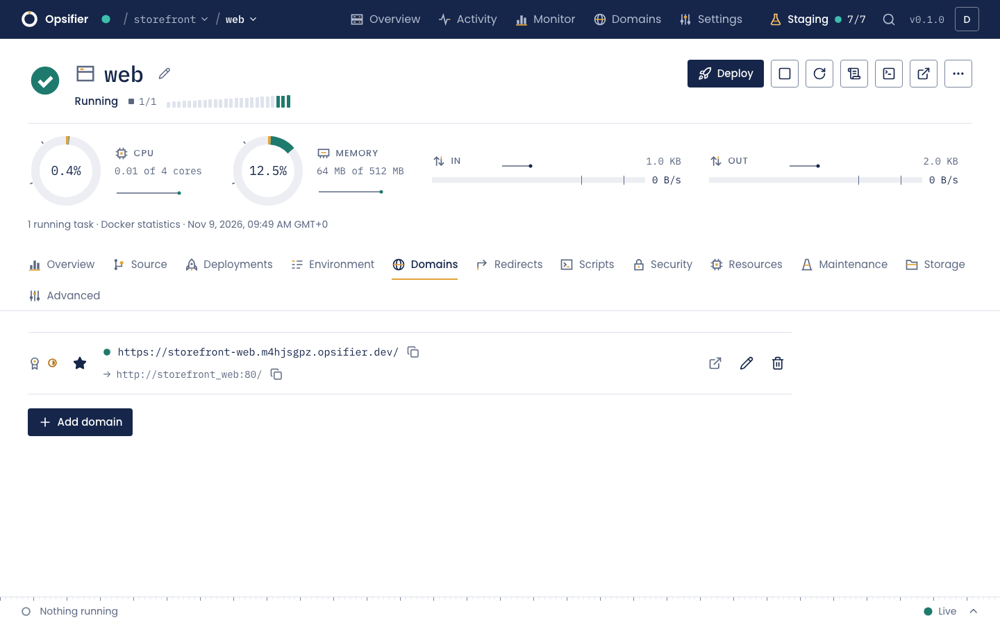<br /><b>Domains.</b> HTTPS by default, with the state of each certificate.</td>
    <td>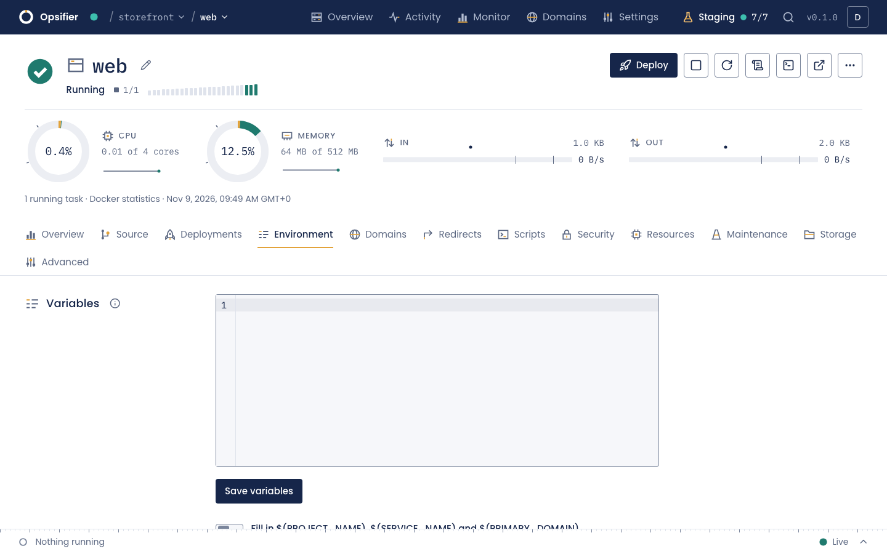<br /><b>Environment.</b> Variables sealed at rest, with build inputs kept apart.</td>
  </tr>
  <tr>
    <td>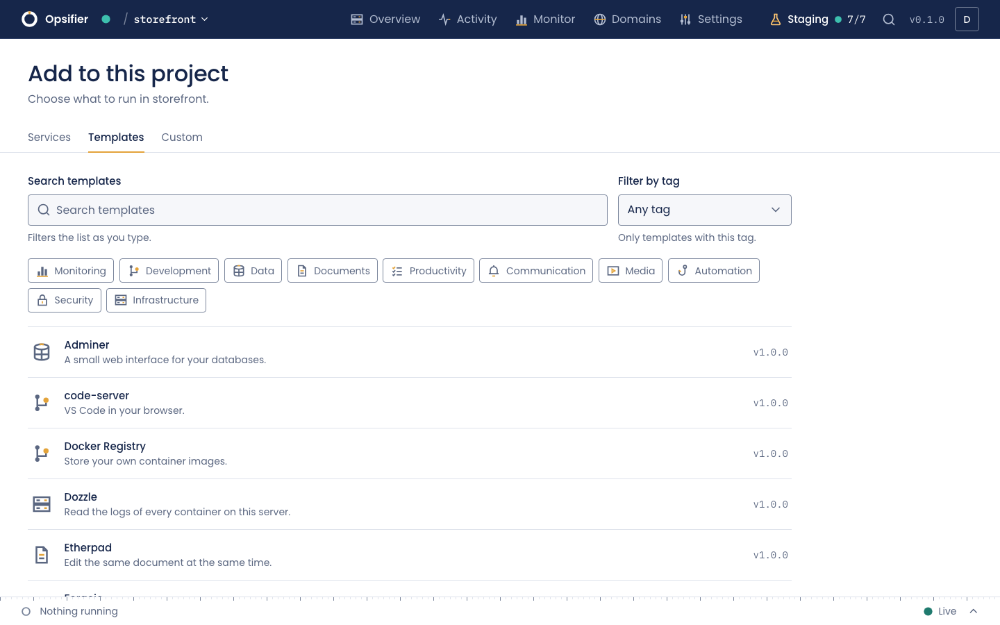<br /><b>Templates.</b> Ready-made apps to install in a few clicks.</td>
    <td>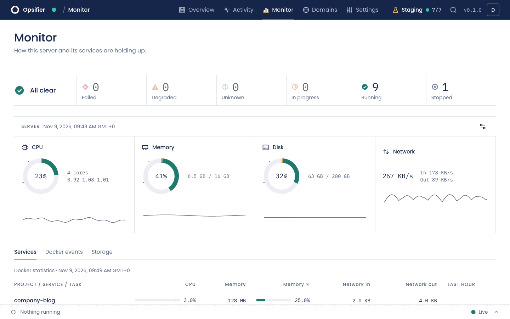<br /><b>Monitoring.</b> The server and every service, with their history.</td>
  </tr>
  <tr>
    <td>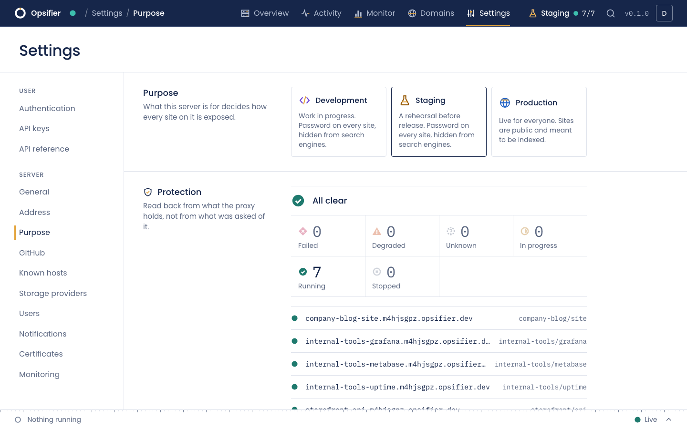<br /><b>Server role.</b> Development, staging or production, and proof of what is protected.</td>
    <td>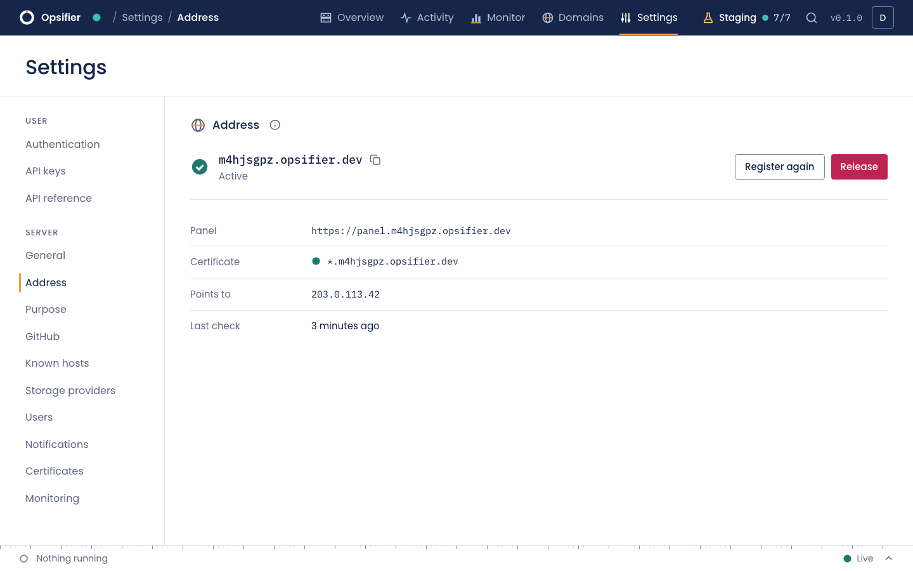<br /><b>Your address.</b> A free name under opsifier.dev, on request, with one wildcard certificate.</td>
  </tr>
  <tr>
    <td>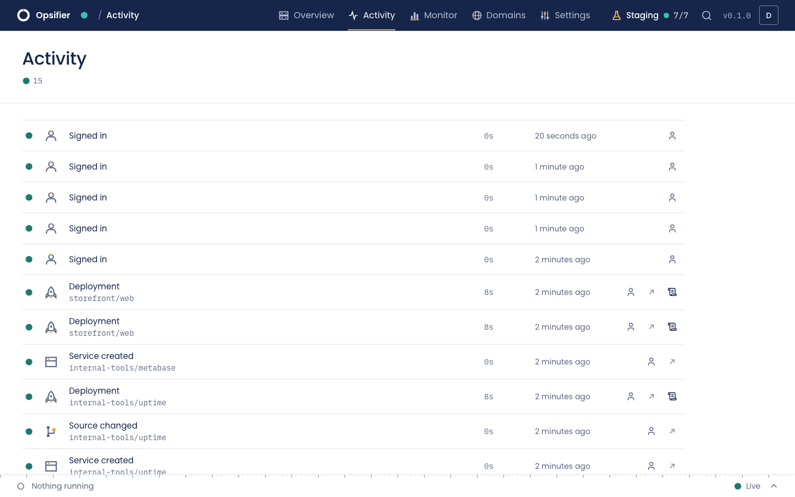<br /><b>Activity.</b> What happened, who did it and how it ended.</td>
    <td>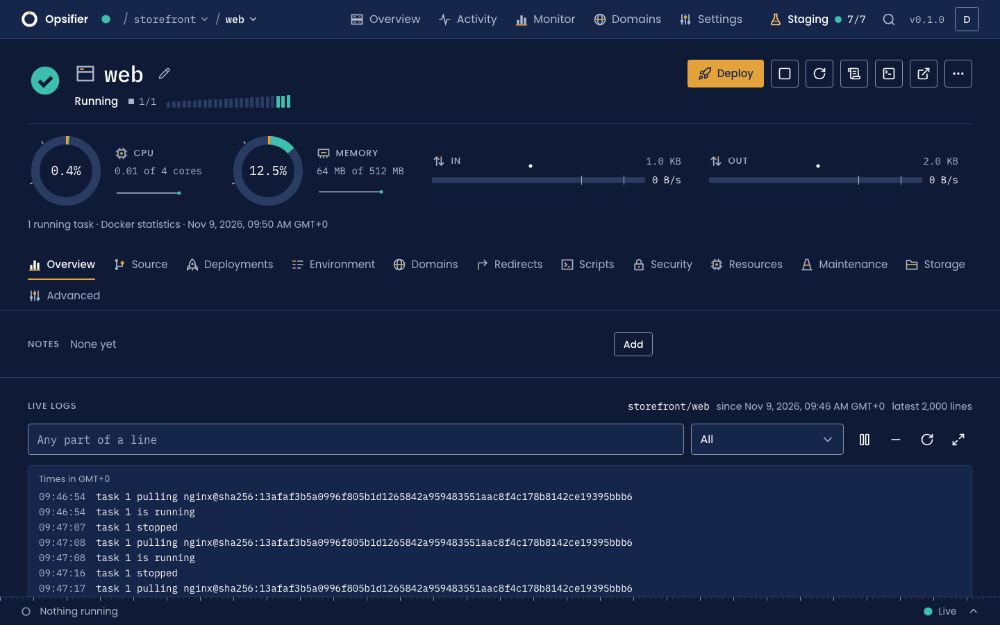<br /><b>Dark theme.</b> Every screen, in both themes.</td>
  </tr>
</table>

<p align="center">
  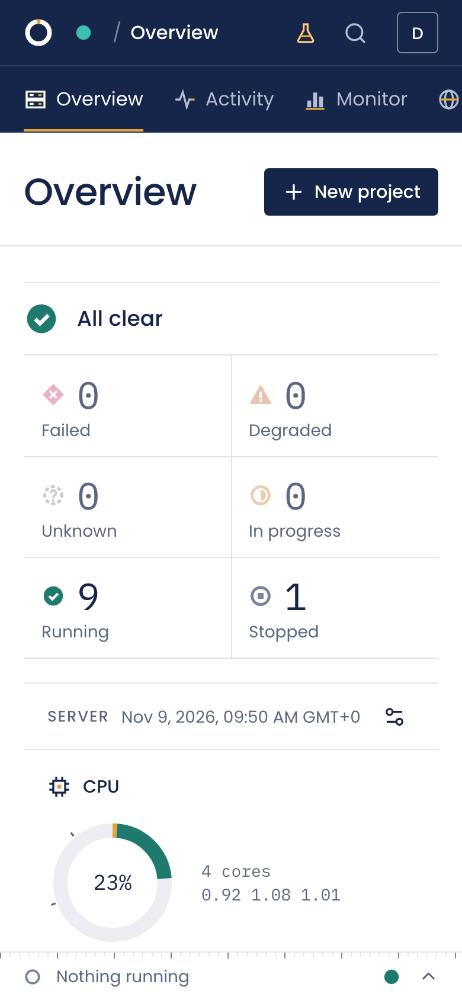
  &nbsp;&nbsp;
  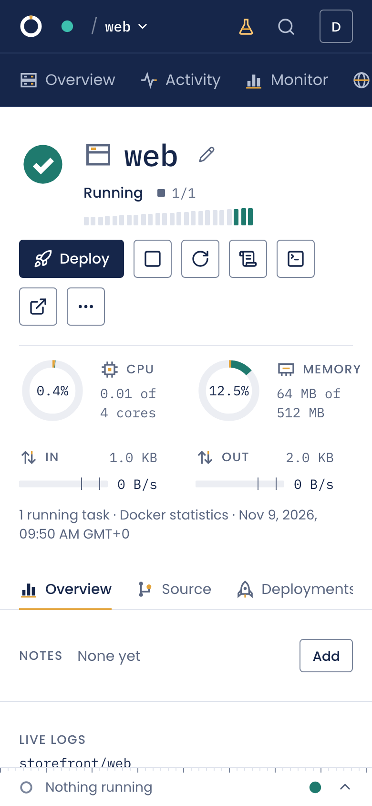
</p>

## Install on a server

On an Ubuntu or Debian server, x86_64 or arm64, with at least 2 GB of memory and ports 80, 443 and 3000 free:

```bash
curl -fsSL https://raw.githubusercontent.com/voidagency/opsifier/main/scripts/install.sh | sudo bash
```

The installer adds Docker when it is missing, sets up Swarm, Traefik and the panel, then prints a one-time link to create the first account. Running it again changes nothing that is already right. Each release is a multi-arch image at `ghcr.io/voidagency/opsifier`, and the panel offers new versions itself. [docs/INSTALL.md](docs/INSTALL.md) lists the installer's options, and [docs/FIRST-APP.md](docs/FIRST-APP.md) takes you from there to a running app.

## Run it locally

You need [Bun](https://bun.sh) and Node.js 22.13 or later.

```bash
bun install
bun run dev
```

Open <http://127.0.0.1:5173>. The first-run page asks for a one-time setup code, which the server prints in its log. Development mode uses a simulated Docker driver, so it changes nothing on your machine.

## How it works

Docker Swarm runs the workloads and Traefik routes the traffic. Desired state lives in SQLite, and every deployment compiles it into a Swarm service and a Traefik route. See [docs/ARCHITECTURE.md](docs/ARCHITECTURE.md) for details.

A server only calls home if you ask for an address. That is the request, then a daily heartbeat, and nothing else. It is documented in the architecture notes.

## Documentation

- [Install on a server](docs/INSTALL.md): requirements, the installer and its options, and the first steps after it.
- [Deploy your first app](docs/FIRST-APP.md): a project, an app from an image or a repository, its domain, and going back to an earlier version.
- [Back up databases and whole servers](docs/BACKUPS.md): destinations, schedules, retention, downloads, restores, and rebuilding a server from its backup.
- [Builders](docs/BUILDERS.md): how source code becomes an image.
- [Command line](docs/CLI.md) and [MCP server](docs/MCP.md): the panel from a terminal, a script or an AI agent.
- [API](docs/API.md): keys, roles, errors and the OpenAPI document.
- [Architecture](docs/ARCHITECTURE.md): how the panel is built, decision by decision.

## FAQ

### What is Opsifier?

An open-source control panel that you install on your own Linux server. From a web interface, it deploys apps from a Docker image, a Git repository, a Dockerfile or an uploaded archive, runs managed Postgres, MySQL, MariaDB, MongoDB and Redis databases and Compose stacks, and takes care of domains and HTTPS, backups, logs and metrics. A command line and an MCP server reach the same API, with the same rights.

### Is it free?

Yes. Opsifier is licensed under Apache 2.0, every feature is included, and there are no paid tiers or license keys. The optional `<id>.opsifier.dev` address is free as well, and issued on request.

### What does it run on?

One Linux server, x86_64 or arm64, with at least 2 GB of memory and ports 80, 443 and 3000 free. The installer is written for Ubuntu and Debian, and adds Docker 26 or later when it is missing. Docker Swarm runs the workloads, Traefik routes the traffic, and the panel keeps its state in a single SQLite file. Multi-node clusters are still to come.

### Is it ready for production?

Not yet. Opsifier is in early development: releases are published, but expect breaking changes, and don't put anything on it yet that you can't afford to lose.

### Does it send data anywhere?

There is no telemetry. A server only calls home if you ask for an `opsifier.dev` address: the request, then a daily heartbeat. The release feed and the Docker version check only read public documents, and say nothing about the server.

## Security

Whoever controls an Opsifier instance has root-equivalent access to its host through the Docker socket, so treat its credentials accordingly. Please report vulnerabilities privately through GitHub security advisories rather than in a public issue.

## License

Apache 2.0. See [LICENSE](LICENSE) and [NOTICE](NOTICE). The panel's image also holds programs and packages from other projects, each under its own license: their texts are in `/usr/share/doc/opsifier/THIRD-PARTY-NOTICES.txt` in the image, and the panel lists them under **Settings, About**. Opsifier is an independent project and is not affiliated with or endorsed by any other control panel vendor.
